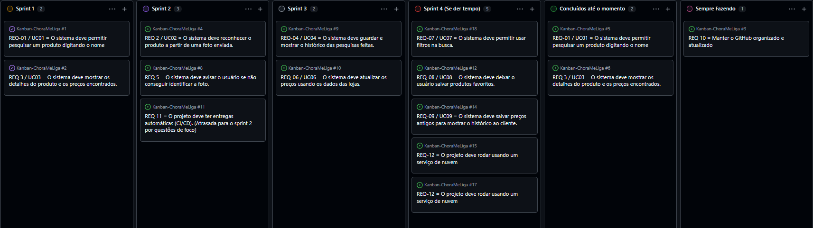

# Chora-me-liga  

Projeto da disciplina Laboratório de Engenharia de Software, Ciência da Computação, Universidade Presbiteriana Mackenzie. Alinhado ao ODS 12 (consumo e produção responsáveis).

Comparador de preços: o usuário pesquisa um produto pelo nome ou por foto e vê em quais lojas ele é mais barato, com histórico de preços.

## Equipe

- Caio Cesar Navarro Pugliese
- Guilherme Clauz Morlina da Silva
- Matheus Lemos Rosal
- Vinicius Barbosa Pereira Allegretti

## Status (Sprint 1)

| Caso de uso | Requisito | Status |
|---|---|---|
| UC01 Pesquisar produto manualmente | REQ-01 | Lógica pronta e testada |
| UC03 Acessar detalhes do produto | REQ-03 | Lógica pronta e testada |
| UC06 Atualizar preços | REQ-06 | Lógica pronta (fonte simulada) |

## Arquitetura

O sistema adota uma arquitetura em camada, em `Codigos/br/mackenzie/chorameliga/`:

| Pasta | Responsabilidade |
|---|---|
| `model` | Entidades e regras de negócio (`Produto`, `Oferta`) |
| `repository` | Armazenamento e busca de produtos |
| `fonte` | Origem dos preços (`FontePrecos`); hoje uma implementação simulada |
| `service` | Casos de uso (pesquisa, detalhes, atualização de preços) |
| `dto` | Dados prontos para a tela (`DetalhesProduto`, `OfertaDetalhe`) |

Os testes ficam em `CodigosTest/`, espelhando a mesma estrutura.

Os preços vêm da interface `FontePrecos`. Por enquanto usamos dados simulados.

## Tecnologias Por Enquanto

- Java
- Maven
- JUnit

## Como rodar os testes

```bash
mvn clean test
```

## Fluxo de trabalho

- Quadro Kanban: 
