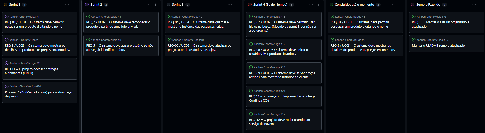

# Chora-me-liga

Projeto da disciplina Laboratório de Engenharia de Software, Ciência da Computação, Universidade Presbiteriana Mackenzie. Alinhado ao ODS 12 (consumo e produção responsáveis).

Comparador de preços: o usuário pesquisa um produto pelo nome, por voz ou por foto e vê em quais lojas ele é mais barato, com histórico de preços.

## Equipe

- Caio Cesar Navarro Pugliese
- Guilherme Clauz Morlina da Silva
- Matheus Lemos Rosal
- Vinicius Barbosa Pereira Allegretti

## Status

### Sprint 1 (concluída)

| Item | Requisito | Status |
|---|---|---|
| UC01 Pesquisar produto pelo nome | REQ-01 | Pronto, com API e tela |
| UC03 Ver detalhes e preços do produto | REQ-03 | Pronto, com API e tela |
| Integração com a API do Mercado Livre | — | Pronta (produtos, ofertas e filtro por categoria) |
| Entrega automática (CI) | REQ 11 | Testes rodam no GitHub Actions a cada push e pull request |

### Sprint 2 (em andamento)

| Item | Requisito | Status |
|---|---|---|
| UC02 Reconhecer o produto por foto | REQ 2 | Em andamento: contrato do reconhecedor e versão simulada prontos; falta escolher o serviço de IA |
| Avisar quando a foto não for identificada | REQ 5 | Em andamento: o reconhecedor já indica quando não reconhece; falta a mensagem na tela |

### Extra

- **Pesquisa por voz:** botão de microfone ao lado do campo de pesquisa. O nome falado vira texto e a pesquisa é feita automaticamente. Usa o reconhecimento de fala do navegador (Chrome e Edge); em navegadores sem suporte o botão não aparece.

## Arquitetura

O sistema adota uma arquitetura em camadas, em `Codigos/br/mackenzie/chorameliga/`:

| Pasta | Responsabilidade |
|---|---|
| `controller` | API REST (`/api/produtos`) e tratamento de erros |
| `service` | Casos de uso: pesquisa, detalhes, importação do catálogo e atualização de preços |
| `model` | Entidades e regras de negócio (`Produto`, `Oferta`) |
| `repository` | Armazenamento e busca de produtos |
| `dto` | Dados prontos para a tela (`ProdutoResumo`, `DetalhesProduto`, `OfertaDetalhe`) |
| `catalogo` | Origem dos produtos e ofertas (`FonteCatalogo`): Mercado Livre ou dados simulados |
| `fonte` | Origem da atualização de preços (`FontePrecos`) |
| `reconhecimento` | Reconhecimento de produto por foto (`ReconhecedorFoto`), hoje com versão simulada |
| `config` | Configuração dos componentes do Spring |

A tela fica em `src/main/resources/static/` (HTML, CSS e JavaScript, sem framework).

Os testes ficam em `CodigosTest/`, espelhando a mesma estrutura.

## API

| Método | Caminho | Descrição |
|---|---|---|
| GET | `/api/produtos?nome=...&dominio=...` | Pesquisa produtos pelo nome; `dominio` (opcional) filtra pela categoria do Mercado Livre, ex.: `MLB-CELLPHONES` |
| GET | `/api/produtos/{id}` | Detalhes de um produto com as ofertas das lojas |

## Tecnologias

- Java 17
- Spring Boot 3.5
- Maven
- JUnit 5
- HTML, CSS e JavaScript
- API do Mercado Livre
- GitHub Actions

## Como rodar

Na raiz do projeto:

```bash
mvn spring-boot:run
```

Depois abra http://localhost:8080.

Sem configuração, o sistema usa dados simulados (ex.: pesquise "Galaxy S23"). Para usar o Mercado Livre, defina as variáveis de ambiente antes de rodar:

| Variável | Obrigatória | Descrição |
|---|---|---|
| `ML_CLIENT_ID` | Sim | ID do aplicativo no Mercado Livre |
| `ML_CLIENT_SECRET` | Sim | Segredo do aplicativo no Mercado Livre |
| `ML_DOMINIO` | Não | Limita as pesquisas a uma categoria, ex.: `MLB-CELLPHONES` |

No PowerShell:

```powershell
$env:ML_CLIENT_ID = "seu_id"
$env:ML_CLIENT_SECRET = "seu_segredo"
mvn spring-boot:run
```

A pesquisa por voz precisa de Chrome ou Edge, de acesso ao microfone e de internet, e só funciona em `localhost` ou em HTTPS.

## Como rodar os testes

```bash
mvn clean test
```

## Fluxo de trabalho

- Quadro Kanban: 
- Cada funcionalidade é feita numa branch `feature/...` e entra na `main` por pull request.
